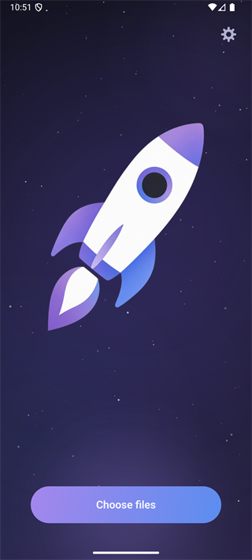
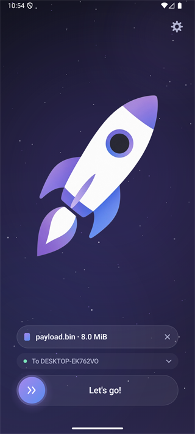
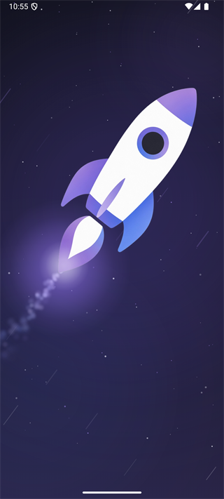
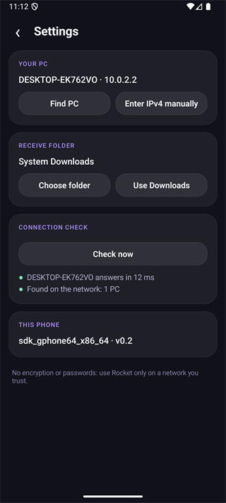
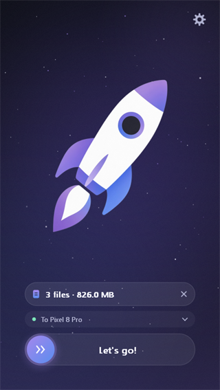
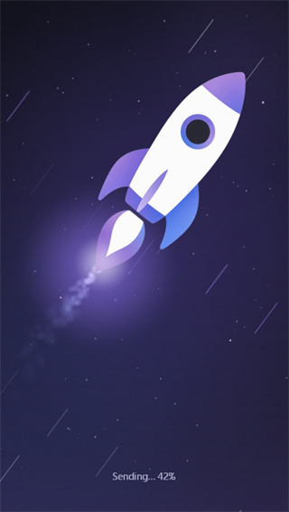
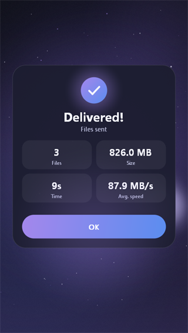
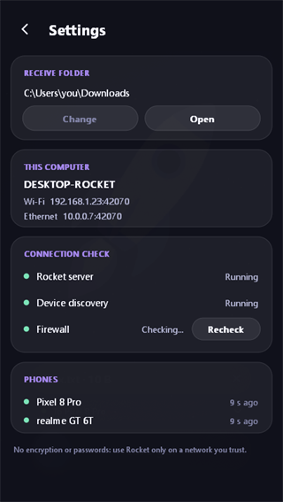

<p align="center">
  
</p>

<h1 align="center">Rocket</h1>

<p align="center">
  Move files between your Windows PC and your Android phone over Wi-Fi: pick files, slide, fly.<br>
  One screen with a rocket and a few buttons, on both devices. No accounts, no cloud, no telemetry, no nonsense.
</p>

<p align="center">
  <a href="https://github.com/lemitz/Rocket/releases"></a>
  
  
  
  
  
</p>

<p align="center">
  <b>English</b> · <a href="README.ru.md">Русский</a>
</p>

---

Rocket does one thing: it sends the files you pick on one device to the other one, as directly as possible. You pick the files, drag the **Let's go!** slider to the right, the controls fade away and the rocket takes off. When the last file has arrived and been verified, the rocket leaves through the top of the screen and the numbers - files, size, time, average speed - appear out of the smoke. That is the whole interface, and it is the same on the PC and on the phone. Everything you only need once (which PC, which folder, checks) lives behind the gear.

It is two tiny apps, not a framework: a single Windows executable written in Go with only the standard library, and an Android app written in Kotlin with only platform APIs - no Compose, no AndroidX, no third-party libraries.

<p align="center">
  
  
  
  
</p>
<p align="center">
  
  
  
  
</p>

## Features

**Sending**
- **Phone to PC:** choose files in the app (or use *Share* from the Gallery and any other app), slide, done. They land in your Windows `Downloads` folder, or in a folder of your choice
- **PC to phone:** choose files in the window (or drag them onto it), slide, and the phone downloads them by itself while Rocket is open on its screen. The files are read from where they are; nothing is copied to a staging folder first
- Several files at once (up to 256 from the PC), files up to 1 TiB, one connection per batch. Nothing is overwritten: a name clash becomes `name (1).ext`
- Every file is checked with CRC32C and written to a temporary file first, so a broken or cancelled transfer never leaves a half file behind
- The result card shows how many files arrived, how much data, how long it took and the average speed. The PC counts a file as delivered only after the phone confirms it
- Two phones can send to the same PC at the same time; their statistics are never mixed

**Finding each other**
- No pairing and no IP addresses to type: the phone finds the PC on the network by itself, and the PC sees every phone that has Rocket open
- One device around: Rocket chooses it and remembers it. Several: you choose once, on the sender, with one tap, and that is remembered too
- If the PC gets a new IP address (DHCP), the phone finds it again by its ID without asking
- If discovery does not work on your network (guest Wi-Fi with client isolation, for example), type the PC's IPv4 address in the phone's settings

**The rocket**
- The rocket is drawn from the app icon; the same scene runs on both devices: it shakes and lifts off, streaks fly past, a flame trail follows, it leaves through the top edge, smoke gathers and the statistics card rises out of it
- Drawing follows the display's own refresh rate (Android `postInvalidateOnAnimation` plus a high-refresh request, Windows Direct2D with vsync); a still screen is not redrawn at all
- Dark interface, antialiased at any display scale. English or Russian, chosen from the system language
- Android: a themed monochrome launcher icon and haptic feedback on the slider and the result; Windows: a dark title bar and per-monitor DPI

**Settings (the gear)**
- **PC:** the receive folder (change, open), the PC's addresses, a connection check - server, device discovery and Windows Firewall, with a *Fix* button that asks for permission once - and the phones seen recently
- **Phone:** which PC is selected (find it, or type its address), the receive folder (system `Downloads` or any folder you choose), a *Check now* button that shows the latency to the PC, the phone name and version

**Everything else**
- A single portable executable on Windows and one APK on Android; no installer, no service, no background process. Closing the window stops everything
- No telemetry and no internet access: Rocket only speaks to devices on your local network
- On Android no broad storage permission is requested: files are read through the system picker and saved to `Download` through MediaStore (or a folder you grant)

> **No encryption, no passwords.** Rocket is made for a network you trust, such as your home Wi-Fi. Anyone on that network could send files to your PC. Do not use it on public Wi-Fi. See [SECURITY.md](SECURITY.md).

## How to use

1. Run `Rocket-<version>-win-x64.exe` on the PC and install `Rocket-<version>-android.apk` on the phone. Keep both open while you transfer.
2. **Phone to PC:** on the phone press *Choose files*, slide **Let's go!**
3. **PC to phone:** on the PC press *Choose files* or drop files on the window, make sure the phone is shown in the *To …* line, slide **Let's go!** The phone must be open with its screen on.

Slide to the right far enough (about 85%) and release; let go earlier and the slider springs back. *Cancel* appears quietly under the flying rocket on the phone, and the Back button cancels too.

## Installation

Download the files from the [Releases](https://github.com/lemitz/Rocket/releases) page:

- **Windows:** `Rocket-<version>-win-x64.exe` - nothing to install. The first time Windows SmartScreen may warn about an unsigned app: *More info* → *Run anyway*. Windows 10 or 11, 64-bit.
- **Android:** `Rocket-<version>-android.apk` - open it on the phone and allow installing from your browser or file manager. Android 14 or newer.
- `SHA256SUMS.txt` - checksums. In PowerShell: `Get-FileHash .\Rocket-0.2.0-win-x64.exe -Algorithm SHA256`.

**Windows firewall:** the PC has to accept connections from the phone. On first use open the gear and press **Fix** next to *Firewall* (Windows asks for permission once), or run `rocket.exe firewall install` from an administrator terminal. It opens TCP 42070 and UDP 42069 for the **Private** network profile and the local subnet only; Rocket never changes firewall rules on its own. Also check that the PC's network profile is *Private* and that the Wi-Fi has no client isolation.

Rocket does not update itself. APKs signed with a different key cannot be installed over each other; see [Releasing](#releasing) if you build your own.

## Development

Requirements: [Go](https://go.dev/dl/) 1.25+ and, for the phone app, JDK 21 and the Android SDK (API 36). Nothing else; there are no packages to install.

```bash
go vet ./...
go test -race ./...                    # protocol, transfers, outbox, the window's state machine
go run ./cmd/rocket                    # the PC app (Windows)
go run ./cmd/rocket daemon             # server only, in the console, for diagnostics
cd android && ./gradlew :app:assembleDebug     # gradlew.bat on Windows
```

The window can be reviewed without opening it: `ROCKET_SNAPSHOT_DIR=out go test ./internal/desktop -run TestRenderStates` writes a PNG of every screen state in English and Russian. [docs/BUILD_TEST.md](docs/BUILD_TEST.md) also describes the end-to-end check with the Android emulator, and [docs/OPEN_ISSUES.md](docs/OPEN_ISSUES.md) lists what is known to be unfinished or untested.

## Building

```powershell
./scripts/build.ps1                  # tests, rocket.exe and the APK into dist/ with SHA256SUMS.txt
./scripts/build.ps1 -SkipTests       # faster
./scripts/build.ps1 -Offline         # Gradle without network (needs a warm cache)
```

The version is a single line in [`VERSION`](VERSION): it goes into `rocket.exe version`, the APK's `versionName`, and the release tag. The icon is `assets/icon-source.png`; `go run ./tools/genassets` turns it into the rocket sprite, the Android launcher icons and the Windows `.ico`.

## Releasing

[`build.yml`](.github/workflows/build.yml) does everything:

- **Pull request to `main`:** formatting, `go vet`, `go test -race`, the exe and the APK are built and attached to the run as artifacts, so the change can be tried before merging. The run says whether merging will publish a release.
- **Merge to `main`:** the same build, then a **GitHub Release `v<VERSION>`** is published with `Rocket-<version>-win-x64.exe`, `Rocket-<version>-android.apk` and `SHA256SUMS.txt`, with [`RELEASE_NOTES.md`](RELEASE_NOTES.md) plus the list of merged pull requests as its text. If that tag already exists nothing is published, so ordinary pull requests only build.
- **"Run workflow" button:** builds any branch, never publishes.

To ship a release, put these in the pull request: a new version in `VERSION` and a matching `RELEASE_NOTES.md` that starts with `# Rocket v<version>` (`./scripts/check-release.ps1` checks both, the workflow runs it too). Merge, and the release appears.

**Signing the APK.** Without secrets the release APK is signed with a throw-away debug key, which works but means every release has to be uninstalled before the next one is installed. Do it once properly:

```powershell
./scripts/make-keystore.ps1          # creates the key outside the repo and prints the four secrets
```

Add `ANDROID_KEYSTORE_BASE64`, `ANDROID_KEYSTORE_PASSWORD`, `ANDROID_KEY_ALIAS` and `ANDROID_KEY_PASSWORD` under *Settings → Secrets and variables → Actions* and keep a backup of the key: a lost key means users must uninstall to update.

## Project structure

```
VERSION                    the version of everything
assets/                    icon-source.png (the icon), icon-circle.png
tools/genassets/           icon pipeline: sprite, launcher icons, .ico (standard library only)
scripts/                   build.ps1, check-release.ps1, make-keystore.ps1
cmd/rocket/                entry point, CLI (daemon, firewall, settings), Windows resources (icon, manifest)
internal/
  wire/                    protocol frames
  server/                  TCP sessions: put, poll, offer-get, offer-done, transfer statistics
  outbox/                  files the PC addressed to phones (kept in memory)
  fsx/                     temporary files, safe names, publishing without overwriting
  discovery/               UDP answer for "who is here"
  config/                  settings, PC id, the Windows Downloads folder
  desktop/                 the PC window: software renderer, scene, settings, Direct2D presenter
android/app/               the phone app: LaunchView (the scene), MainActivity, SettingsPanel, protocol, storage
docs/                      HANDOFF, ARCHITECTURE, PROTOCOL, BUILD_TEST, OPEN_ISSUES (in Russian)
.github/                   the build and release workflow, issue and pull request templates
```

The split is deliberate: the PC is always the listening side and the phone opens every connection. To send a file *from* the PC, the PC puts a reference to the file in memory and tells the phone about it the next time the phone asks (about once a second while Rocket is open); the phone then downloads it. There is no browsing of the other device's files, and no command to fetch an arbitrary path. The wire format is documented in [docs/PROTOCOL.md](docs/PROTOCOL.md).

## Tech stack

[Go](https://go.dev) (standard library only) · Win32, GDI and [Direct2D](https://learn.microsoft.com/windows/win32/direct2d/direct2d-portal) through system DLLs · [Kotlin](https://kotlinlang.org) with Android platform APIs only · [Gradle](https://gradle.org) · [GitHub Actions](https://github.com/features/actions)

## License

Rocket is released under the [MIT License](LICENSE). It contains no third-party runtime code, see [THIRD-PARTY-NOTICES.md](THIRD-PARTY-NOTICES.md).

---

<p align="center">
  <br>
  <sub>This project was built with the help of AI tools.</sub>
</p>
